I work on post-training data and RL environments at [AfterQuery](https://www.afterquery.com). Before that I built agents on the Enterprise AI team at [Scale AI](https://scale.com), and before that I was a founding engineer at [Roe](https://www.roe-ai.com) (YC), where I ended up running agent engineering. We put agents for ERP, fraud and compliance work in front of banks and Fortune 500 teams.

On my own time I write a lot of Rust and do research on how agents learn from long trajectories. Work commits go to a different account, so everything here is side projects.

### Research

**[Branch-Aware Hindsight Credit Assignment for LLM Agents](https://github.com/jadenfix/CreditAssignment/blob/main/paper/main.pdf)** · [code](https://github.com/jadenfix/CreditAssignment) 
Most agent training pipelines score an episode by how it ended and give that score to every step. If the agent tries to take the mug, fails, pokes at the counter, then takes the mug, all of those steps get the same credit. Poking never fails, so the policy learns to poke. Trained this way, agents do worse than untrained ones (0.24 vs 0.79 success). Scoring steps with signals the environment already gives you gets it to 1.00, and the effect holds on real ALFWorld with Claude Haiku and Qwen-7B.

**[Critique-Transport Smoothing](https://github.com/jadenfix/CreditAssignment-LongHorizon)** · in progress 
Does pulling an agent's latent trajectory toward a critique, using optimal transport, beat GRPO with a verifier on long-horizon math and code? Written in JAX on Tunix and MaxText.

**[Predictive Stochastic Modeling for Financial Markets](https://github.com/jadenfix/Predictive-Stochastic-Modeling-for-Financial-Markets-/blob/main/Predictive_Stochastic_Modeling_for_Financial_Markets.pdf)** · Adam Smith Award 
My undergrad thesis. Forecasting S&P 500 bear markets with Bayesian Markov-switching models.

### Things I've built

**[rusty](https://github.com/jadenfix/rusty)** is a coding agent for the terminal, shipped as one static Rust binary. It can't call a goal done without showing evidence, its memories lose confidence when the tests behind them start failing, and it will run `cargo test` without asking but not `rm -rf`. Open models on NVIDIA by default, or Claude and GPT.

**[FullStack-Bench](https://github.com/jadenfix/FullStack-Bench)** asks whether an agent can ship a real full-stack change without taking production down. Tasks run on SimCloud, a fake cloud with synthetic users on prod and a tamper-evident incident log. You pass only if the work is done and nothing broke along the way.

**Tempera** is a set of Rust services for agents to run on, about 2,000 commits so far:

- [tempo](https://github.com/jadenfix/tempo): a browser that gives the model structured, diff-able page state instead of screenshots
- [Palette](https://github.com/jadenfix/palette): traces, evals, and a CI gate that only passes changes that generalize
- [temp.js](https://github.com/jadenfix/temp.js): V8, CPython and Rust in one process, with agent loops that survive `kill -9`
- [remi](https://github.com/jadenfix/remi): memory built from append-only traces, with provenance on every answer
- [cradle](https://github.com/jadenfix/cradle): a capability sandbox on Wasmtime that fails closed
- [tempOS](https://github.com/jadenfix/tempOS): authority, policy and receipts at the OS layer
- [Arrha](https://github.com/jadenfix/arrha): settlement for agent payments on a small Rust L1

**[Spacewind](https://github.com/jadenfix/space-simulation-engine)** is a C11 physics engine for asking whether a spacecraft can push off sunlight, solar wind and gravity. Kerr and Schwarzschild geodesics, 3D3V plasma, N-body. The orbit at the top of this page is the same kind of math.

Also [ReplayKit](https://github.com/jadenfix/ReplayKit) (fork an agent run from any step and replay it), [trading](https://github.com/jadenfix/trading) (Rust bots on Kalshi), and [MiniGPTEngine-CPP](https://github.com/jadenfix/MiniGPTEngine-CPP) (GPT inference from scratch in C++).

### Some commits I like

- [`40210c7`](https://github.com/jadenfix/arrha/commit/40210c7) arrha: batch-verify BLS signatures with blst multi-pairing
- [`8618e7a`](https://github.com/jadenfix/arrha/commit/8618e7a) arrha: constant-time audit of the VRF and KES code
- [`e07d8a7`](https://github.com/jadenfix/palette/commit/e07d8a7) palette: a CI gate that can say *inconclusive* instead of guessing
- [`3d92b8a`](https://github.com/jadenfix/tempo/commit/3d92b8a) tempo: detect when a page has settled from events instead of polling
- [`2df8415`](https://github.com/jadenfix/rusty/commit/2df8415) rusty: a task doesn't count as passed if the agent edited its guard to get there
- [`ad8e6d7`](https://github.com/jadenfix/space-simulation-engine/commit/ad8e6d7) spacewind: fix the midpoint solve where the electric field crosses zero

Open PRs upstream: [agent-browser](https://github.com/vercel-labs/agent-browser/pull/2143), [harbor](https://github.com/harbor-framework/harbor/pull/3730), [just-bash](https://github.com/vercel-labs/just-bash/pull/583).

[jadenfix.github.io](https://jadenfix.github.io) · [LinkedIn](https://linkedin.com/in/jadenfix) · DMs open if you're building something interesting
